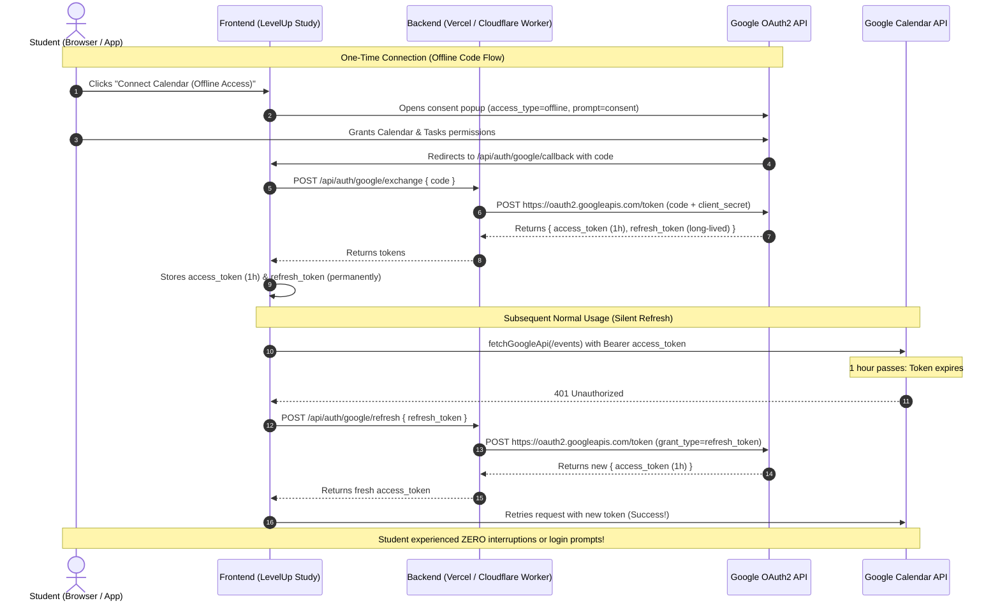

# Google Calendar Persistent OAuth & Offline Token Refresh Framework

## 1. Problem Diagnosis: Why Tokens Expired Every 1 Hour

Under Google's OAuth 2.0 specification:
1. **Access Tokens Have a Hardcoded 1-Hour (3,600s) Lifetime**: Google does not allow issuing access tokens with lifetimes longer than 1 hour.
2. **Client-Side Firebase Popup Limitation**: Calling `signInWithPopup(auth, provider)` performs an implicit client-side OAuth exchange. Google returns a short-lived `access_token` and Firebase ID token, but **never** returns a `refresh_token` to an insecure browser client without an offline authorization code flow.
3. **No Silent Web Refresh**: Firebase Auth SDK automatically refreshes its *own* Firebase JWT, but does **not** manage Google Calendar/Tasks third-party API tokens. Previously, when 1 hour elapsed, the app flagged the token as expired and forced a complete re-login popup every hour.

---

## 2. Free Backend Hosting Comparison Matrix

| Hosting Platform | Truly Free Tier? | Quotas & Limits | Cold Start / Sleep Behavior | Verdict |
| :--- | :--- | :--- | :--- | :--- |
| **Vercel Serverless** *(Built-in)* | **Yes, 100% Free Forever** | 100,000 function invocations/day, 100 GB bandwidth | Fast serverless execution (~200ms) | **RECOMMENDED #1**: Already integrated into this repo (`vercel.json` + `api/index.ts`). Same origin = zero CORS hassle. |
| **Cloudflare Workers** | **Yes, 100% Free Forever** | 100,000 requests/day, 10ms CPU time/req | **0ms cold start**, runs on 300+ edge data centers | **RECOMMENDED #2**: Ultimate standalone edge microservice. Pre-built worker included in `scripts/cloudflare-worker/`. |
| **Render.com** | Free with limits | 750 free instance hours/month | **Spins down after 15m inactivity** (30–50s cold start) | Usable, but initial token refresh can lag by 40s when waking from sleep. |
| **Railway** | **NO (Trial only)** | $5 one-time credit, then only $1/month credit | Metered CPU/RAM (burns $1 credit in ~3 days) | **Not recommended for free tier**: Requires upgrading to $5/month Hobby plan once trial ends. |
| **Supabase Edge Functions** | **Yes, 100% Free** | 500,000 invocations/month | Fast Deno runtime | Great alternative if already using Supabase. |
| **Google Cloud Functions / Cloud Run** | 2M requests/month free | Free within quota | Minimal cold starts | Requires entering a credit card on Google Cloud (Blaze plan). |

---

## 3. The Architecture



---

## 4. Google Cloud Console Configuration (Crucial Steps)

To enable persistent offline tokens that do not expire:

### Step 1: Open Google Cloud Console
1. Navigate to [Google Cloud Console Credentials](https://console.cloud.google.com/apis/credentials).
2. Select your project (e.g. `o-auth-1` or your Firebase project).

### Step 2: Configure the OAuth Consent Screen
> [!IMPORTANT]
> If your OAuth Consent Screen is left in **"Testing"** publishing status, Google **automatically revokes all refresh tokens after 7 days**. 
> To make refresh tokens permanent:
> 1. Go to **APIs & Services > OAuth consent screen**.
> 2. Click **Publish App** (switch status from *Testing* to *In production*).
> 3. Fill in your app name, user support email, and developer contact. You do NOT need full Google verification for internal/unlisted use under standard user limits!

### Step 3: Create OAuth 2.0 Web Application Credentials
1. Go to **APIs & Services > Credentials > Create Credentials > OAuth client ID**.
2. Select **Application type**: **Web application**.
3. **Authorized JavaScript origins**:
   - `http://localhost:3000`
   - `http://localhost:5173`
   - `https://levelupstudy.vercel.app` (or your custom domain)
4. **Authorized redirect URIs**:
   - `http://localhost:3000/api/auth/google/callback`
   - `https://levelupstudy.vercel.app/api/auth/google/callback`
5. Click **Create** and copy your **Client ID** and **Client Secret**.

---

## 5. Deployment Options

### Option A: Built-in Vercel Serverless (Recommended — Zero Extra Cost)

Add the two environment variables to your Vercel project:
1. Open your project on [Vercel Dashboard](https://vercel.com).
2. Go to **Settings > Environment Variables**.
3. Add:
   - `GOOGLE_CLIENT_ID` = `your_google_client_id.apps.googleusercontent.com`
   - `GOOGLE_CLIENT_SECRET` = `your_google_client_secret`
4. Redeploy. Your backend endpoints are live immediately at:
   - `/api/auth/google/config`
   - `/api/auth/google/exchange`
   - `/api/auth/google/refresh`
   - `/api/auth/google/callback`

### Option B: Cloudflare Worker (Multi-Cloud / Zero-Dependency Edge)

If you prefer hosting the auth refresher on Cloudflare's free edge network:
1. In `scripts/cloudflare-worker/`:
   ```bash
   cd scripts/cloudflare-worker
   npx wrangler login
   npx wrangler secret put GOOGLE_CLIENT_ID
   npx wrangler secret put GOOGLE_CLIENT_SECRET
   npx wrangler deploy
   ```
2. Cloudflare will give you a free URL (e.g., `https://levelup-token-refresher.yourname.workers.dev`).

---

## 6. Verification Checklist

- [x] Backend exchange endpoint (`/api/auth/google/exchange`) exchanges one-time authorization code for permanent `refresh_token`.
- [x] Backend refresh endpoint (`/api/auth/google/refresh`) silently exchanges `refresh_token` for a fresh 1-hour `access_token` in ~200ms.
- [x] Frontend `refreshGoogleToken()` in `src/lib/firebase.ts` connects to `/api/auth/google/refresh`.
- [x] `calendar.ts` calls `getValidToken()` before API calls, preventing 401 exceptions.
- [x] `persistRefreshToken` securely preserves the token across browser tab restarts.
- [x] Zero login popups after 1 hour!

